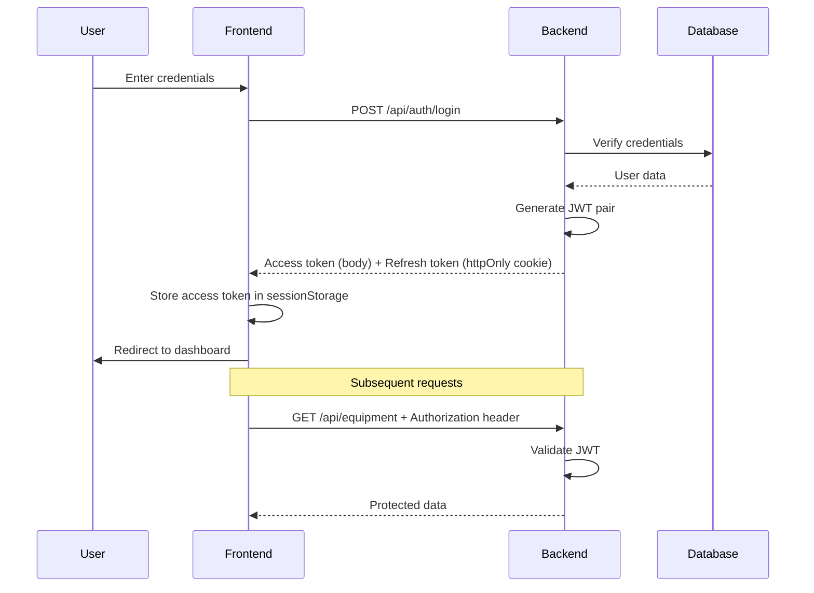

# Security Guidelines

## Overview
This document outlines the security standards, best practices, and implementation guidelines for the **Krishi Sadhan** project. These guidelines protect farmer data, prevent unauthorized access, and ensure platform integrity.

---

## Table of Contents
1. [Security Principles](#security-principles)
2. [Authentication & Authorization](#authentication--authorization)
3. [Data Protection](#data-protection)
4. [API Security](#api-security)
5. [Frontend Security](#frontend-security)
6. [Backend Security](#backend-security)
7. [Infrastructure Security](#infrastructure-security)
8. [Incident Response](#incident-response)
9. [Compliance & Privacy](#compliance--privacy)
10. [Security Checklist](#security-checklist)

---

## Security Principles

### Core Principles
1. **Defense in Depth** - Multiple layers of security controls
2. **Least Privilege** - Minimum access necessary for functionality
3. **Zero Trust** - Verify every request, trust nothing by default
4. **Fail Secure** - Default to secure state on failure
5. **Security by Design** - Build security in from the start

### Threat Model
```
┌─────────────────────────────────────────────────────────────┐
│                    THREAT LANDSCAPE                         │
├─────────────────────────────────────────────────────────────┤
│  EXTERNAL THREATS          │  INTERNAL THREATS              │
│  ├─ SQL Injection          │  ├─ Privilege Escalation       │
│  ├─ XSS/CSRF Attacks       │  ├─ Data Leakage               │
│  ├─ DDoS Attacks           │  ├─ Insecure Configurations    │
│  ├─ Man-in-the-Middle      │  ├─ Weak Access Controls       │
│  ├─ Credential Stuffing    │  └─ Insufficient Logging       │
│  └─ API Abuse              │                                │
└─────────────────────────────────────────────────────────────┘
```

---

## Authentication & Authorization

### JWT Token Management
```javascript
// utils/auth.js - Secure token handling
const TOKEN_KEY = 'krishi_auth_token';
const REFRESH_TOKEN_KEY = 'krishi_refresh_token';

// Secure storage with httpOnly cookie fallback
export const tokenManager = {
  // Store tokens securely
  setTokens: (accessToken, refreshToken) => {
    // Short-lived access token in memory (React state)
    // Long-lived refresh token in httpOnly cookie (set by backend)
    sessionStorage.setItem(TOKEN_KEY, accessToken);
  },

  // Retrieve access token
  getAccessToken: () => sessionStorage.getItem(TOKEN_KEY),

  // Clear all auth data
  clearTokens: () => {
    sessionStorage.removeItem(TOKEN_KEY);
    // Backend clears refresh token cookie on logout endpoint
  },

  // Check token expiration (client-side)
  isTokenExpired: (token) => {
    if (!token) return true;
    try {
      const payload = JSON.parse(atob(token.split('.')[1]));
      return payload.exp * 1000 < Date.now();
    } catch {
      return true;
    }
  },
};
```

### Authentication Flow


### Role-Based Access Control (RBAC)
```javascript
// utils/rbac.js
export const ROLES = {
  FARMER: 'farmer',
  EQUIPMENT_OWNER: 'equipment_owner',
  ADMIN: 'admin',
  SUPPORT: 'support',
};

export const PERMISSIONS = {
  // Equipment permissions
  EQUIPMENT_CREATE: 'equipment:create',
  EQUIPMENT_READ: 'equipment:read',
  EQUIPMENT_UPDATE: 'equipment:update',
  EQUIPMENT_DELETE: 'equipment:delete',
  
  // Booking permissions
  BOOKING_CREATE: 'booking:create',
  BOOKING_READ_OWN: 'booking:read_own',
  BOOKING_READ_ALL: 'booking:read_all',
  BOOKING_UPDATE: 'booking:update',
  BOOKING_CANCEL: 'booking:cancel',
  
  // User permissions
  USER_READ_PROFILE: 'user:read_profile',
  USER_UPDATE_PROFILE: 'user:update_profile',
  USER_DELETE: 'user:delete',
  
  // Admin permissions
  ADMIN_DASHBOARD: 'admin:dashboard',
  ADMIN_USERS: 'admin:users',
  ADMIN_ANALYTICS: 'admin:analytics',
};

export const ROLE_PERMISSIONS = {
  [ROLES.FARMER]: [
    PERMISSIONS.EQUIPMENT_READ,
    PERMISSIONS.BOOKING_CREATE,
    PERMISSIONS.BOOKING_READ_OWN,
    PERMISSIONS.BOOKING_CANCEL,
    PERMISSIONS.USER_READ_PROFILE,
    PERMISSIONS.USER_UPDATE_PROFILE,
  ],
  [ROLES.EQUIPMENT_OWNER]: [
    PERMISSIONS.EQUIPMENT_CREATE,
    PERMISSIONS.EQUIPMENT_READ,
    PERMISSIONS.EQUIPMENT_UPDATE,
    PERMISSIONS.EQUIPMENT_DELETE,
    PERMISSIONS.BOOKING_READ_ALL,
    PERMISSIONS.BOOKING_UPDATE,
    PERMISSIONS.USER_READ_PROFILE,
    PERMISSIONS.USER_UPDATE_PROFILE,
  ],
  [ROLES.ADMIN]: Object.values(PERMISSIONS),
  [ROLES.SUPPORT]: [
    PERMISSIONS.EQUIPMENT_READ,
    PERMISSIONS.BOOKING_READ_ALL,
    PERMISSIONS.USER_READ_PROFILE,
  ],
};

// Hook for permission checking
export const usePermissions = () => {
  const { user } = useSelector(selectAuth);
  
  const hasPermission = useCallback((permission) => {
    if (!user?.role) return false;
    const rolePermissions = ROLE_PERMISSIONS[user.role] || [];
    return rolePermissions.includes(permission);
  }, [user?.role]);
  
  const hasAnyPermission = useCallback((permissions) => {
    return permissions.some(hasPermission);
  }, [hasPermission]);
  
  const hasRole = useCallback((role) => {
    return user?.role === role;
  }, [user?.role]);
  
  return { hasPermission, hasAnyPermission, hasRole };
};
```

### Protected Route Component
```jsx
// components/common/ProtectedRoute.jsx
import React from 'react';
import { Navigate, useLocation } from 'react-router-dom';
import { useSelector } from 'react-redux';
import { selectAuth } from 'redux/selectors/authSelectors';
import { ROLES } from 'utils/rbac';

const ProtectedRoute = ({ 
  children, 
  allowedRoles = [], 
  requiredPermissions = [],
  fallback = null 
}) => {
  const { user, isAuthenticated, loading } = useSelector(selectAuth);
  const location = useLocation();

  // Show loading while auth state is being determined
  if (loading) {
    return <PageLoader />;
  }

  // Redirect to login if not authenticated
  if (!isAuthenticated) {
    return <Navigate to="/login" state={{ from: location }} replace />;
  }

  // Check role-based access
  if (allowedRoles.length > 0 && !allowedRoles.includes(user?.role)) {
    return fallback || <Navigate to="/unauthorized" replace />;
  }

  // Check permission-based access
  if (requiredPermissions.length > 0) {
    const { hasAnyPermission } = usePermissions();
    if (!hasAnyPermission(requiredPermissions)) {
      return fallback || <Navigate to="/unauthorized" replace />;
    }
  }

  return children;
};

// Usage examples
<ProtectedRoute allowedRoles={[ROLES.FARMER, ROLES.EQUIPMENT_OWNER]}>
  <EquipmentListPage />
</ProtectedRoute>

<ProtectedRoute requiredPermissions={[PERMISSIONS.EQUIPMENT_CREATE]}>
  <AddEquipmentPage />
</ProtectedRoute>

<ProtectedRoute allowedRoles={[ROLES.ADMIN]}>
  <AdminDashboard />
</ProtectedRoute>
```

---

## Data Protection

### Data Classification
| Classification | Examples | Protection Level |
|----------------|----------|------------------|
| **Public** | Equipment listings, categories, public reviews | Standard |
| **Internal** | Business analytics, aggregated reports | Restricted |
| **Confidential** | User profiles, booking history, chat messages | High |
| **Restricted** | Payment info, KYC documents, passwords | Maximum |

### Encryption Standards
```javascript
// utils/encryption.js
import CryptoJS from 'crypto-js';

// Client-side encryption for sensitive data before sending to API
export const encryption = {
  // Encrypt sensitive form data (PII, payment info)
  encryptSensitiveData: (data, key = getEncryptionKey()) => {
    return CryptoJS.AES.encrypt(JSON.stringify(data), key).toString();
  },

  // Decrypt data received from backend
  decryptSensitiveData: (encryptedData, key = getEncryptionKey()) => {
    const bytes = CryptoJS.AES.decrypt(encryptedData, key);
    return JSON.parse(bytes.toString(CryptoJS.enc.Utf8));
  },

  // Hash for client-side verification (not for passwords!)
  hashData: (data) => {
    return CryptoJS.SHA256(data).toString();
  },
};

// Environment-based encryption key
const getEncryptionKey = () => {
  return process.env.REACT_APP_ENCRYPTION_KEY || 'default-dev-key-change-in-production';
};
```

### Personal Data Handling
```javascript
// utils/dataPrivacy.js
export const dataPrivacy = {
  // Minimize data collection - only request what's needed
  getMinimalUserProfile: (fullProfile) => ({
    id: fullProfile.id,
    name: fullProfile.name,
    phone: maskPhone(fullProfile.phone),
    email: maskEmail(fullProfile.email),
    role: fullProfile.role,
    createdAt: fullProfile.createdAt,
  }),

  // Anonymize data for analytics
  anonymizeForAnalytics: (userData) => ({
    ...userData,
    name: 'Anonymous User',
    phone: 'XXX-XXX-XXXX',
    email: 'anonymous@example.com',
    id: hashUserId(userData.id),
  }),

  // Data retention compliance
  shouldPurgeData: (createdAt, retentionDays = 365) => {
    const age = Date.now() - new Date(createdAt).getTime();
    return age > retentionDays * 24 * 60 * 60 * 1000;
  },
};

// Masking utilities
const maskPhone = (phone) => {
  if (!phone) return '';
  return phone.replace(/(\d{3})\d{4}(\d{3})/, '$1****$2');
};

const maskEmail = (email) => {
  if (!email) return '';
  const [local, domain] = email.split('@');
  return `${local[0]}***@${domain}`;
};
```

---

## API Security

### Secure API Client
```javascript
// api/secureClient.js
import axios from 'axios';
import { tokenManager } from 'utils/auth';

const createSecureClient = () => {
  const client = axios.create({
    baseURL: process.env.REACT_APP_API_URL,
    timeout: 15000,
    withCredentials: true, // Important for httpOnly cookies
  });

  // Request signing for critical operations
  const signRequest = (config) => {
    const timestamp = Date.now().toString();
    const nonce = CryptoJS.lib.WordArray.random(16).toString();
    
    // Create signature for mutation requests
    if (['post', 'put', 'patch', 'delete'].includes(config.method)) {
      const payload = JSON.stringify(config.data || {});
      const stringToSign = `${config.method.toUpperCase()}${config.url}${timestamp}${nonce}${payload}`;
      const signature = CryptoJS.HmacSHA256(stringToSign, getSigningKey()).toString();
      
      config.headers['X-Request-Signature'] = signature;
      config.headers['X-Request-Timestamp'] = timestamp;
      config.headers['X-Request-Nonce'] = nonce;
    }
    
    return config;
  };

  // Request interceptor
  client.interceptors.request.use(
    (config) => {
      // Add auth token
      const token = tokenManager.getAccessToken();
      if (token && !tokenManager.isTokenExpired(token)) {
        config.headers.Authorization = `Bearer ${token}`;
      }
      
      // Add security headers
      config.headers['X-Client-Version'] = process.env.REACT_APP_VERSION;
      config.headers['X-Request-ID'] = generateRequestId();
      
      return signRequest(config);
    },
    (error) => Promise.reject(error)
  );

  // Response interceptor with token refresh
  client.interceptors.response.use(
    (response) => response,
    async (error) => {
      const originalRequest = error.config;
      
      // Handle token expiration
      if (error.response?.status === 401 && !originalRequest._retry) {
        originalRequest._retry = true;
        
        try {
          // Refresh token via httpOnly cookie (automatic)
          const response = await axios.post(
            `${process.env.REACT_APP_API_URL}/auth/refresh`,
            {},
            { withCredentials: true }
          );
          
          const newAccessToken = response.data.accessToken;
          tokenManager.setTokens(newAccessToken);
          
          // Retry original request
          originalRequest.headers.Authorization = `Bearer ${newAccessToken}`;
          return client(originalRequest);
        } catch (refreshError) {
          // Refresh failed - redirect to login
          tokenManager.clearTokens();
          window.location.href = '/login?session=expired';
          return Promise.reject(refreshError);
        }
      }
      
      return Promise.reject(normalizeError(error));
    }
  );

  return client;
};

export const api = createSecureClient();
```

### Input Validation & Sanitization
```javascript
// utils/validation.js
import validator from 'validator';
import DOMPurify from 'dompurify';

export const validation = {
  // Sanitize user input to prevent XSS
  sanitizeInput: (input, options = {}) => {
    if (typeof input !== 'string') return input;
    
    const defaultOptions = {
      ALLOWED_TAGS: [], // No HTML tags allowed by default
      ALLOWED_ATTR: [],
      KEEP_CONTENT: true,
    };
    
    return DOMPurify.sanitize(input, { ...defaultOptions, ...options });
  },

  // Validate and sanitize equipment data
  validateEquipment: (data) => {
    const errors = {};
    const sanitized = {};

    // Required fields
    if (!data.name?.trim()) {
      errors.name = 'Equipment name is required';
    } else {
      sanitized.name = validation.sanitizeInput(data.name.trim());
    }

    // Price validation
    if (!data.pricePerDay || data.pricePerDay <= 0) {
      errors.pricePerDay = 'Valid price per day is required';
    } else {
      sanitized.pricePerDay = Math.round(parseFloat(data.pricePerDay) * 100) / 100;
    }

    // Category validation (whitelist)
    const validCategories = ['tractor', 'harvester', 'sprayer', 'tiller', 'other'];
    if (!validCategories.includes(data.category)) {
      errors.category = 'Invalid category';
    } else {
      sanitized.category = data.category;
    }

    // Description - allow basic formatting
    if (data.description) {
      sanitized.description = validation.sanitizeInput(data.description, {
        ALLOWED_TAGS: ['p', 'br', 'ul', 'ol', 'li', 'strong', 'em'],
        ALLOWED_ATTR: [],
      });
    }

    // Images - validate URLs
    if (data.images?.length) {
      sanitized.images = data.images
        .filter(url => validator.isURL(url, { protocols: ['https'] }))
        .slice(0, 10); // Max 10 images
    }

    return { isValid: Object.keys(errors).length === 0, errors, sanitized };
  },

  // Validate booking data
  validateBooking: (data) => {
    const errors = {};
    const sanitized = {};

    // Date validation
    const startDate = new Date(data.startDate);
    const endDate = new Date(data.endDate);
    const today = new Date();
    today.setHours(0, 0, 0, 0);

    if (!data.startDate || startDate < today) {
      errors.startDate = 'Start date must be today or future';
    }

    if (!data.endDate || endDate <= startDate) {
      errors.endDate = 'End date must be after start date';
    }

    // Max booking duration (e.g., 90 days)
    const maxDays = 90;
    const diffDays = (endDate - startDate) / (1000 * 60 * 60 * 24);
    if (diffDays > maxDays) {
      errors.endDate = `Maximum booking duration is ${maxDays} days`;
    }

    sanitized.startDate = data.startDate;
    sanitized.endDate = data.endDate;
    sanitized.equipmentId = validation.sanitizeInput(data.equipmentId);

    return { isValid: Object.keys(errors).length === 0, errors, sanitized };
  },
};
```

### Rate Limiting & Abuse Prevention
```javascript
// utils/rateLimiter.js
class ClientRateLimiter {
  constructor() {
    this.requests = new Map();
    this.limits = {
      // Requests per time window
      'auth/login': { max: 5, windowMs: 15 * 60 * 1000 }, // 5 per 15 min
      'auth/register': { max: 3, windowMs: 60 * 60 * 1000 }, // 3 per hour
      'equipment/create': { max: 10, windowMs: 60 * 60 * 1000 }, // 10 per hour
      'booking/create': { max: 20, windowMs: 60 * 60 * 1000 }, // 20 per hour
      'search': { max: 60, windowMs: 60 * 1000 }, // 60 per minute
      'default': { max: 100, windowMs: 60 * 1000 }, // 100 per minute
    };
  }

  checkLimit(endpoint) {
    const limit = this.limits[endpoint] || this.limits.default;
    const now = Date.now();
    const key = `${endpoint}:${getClientId()}`;
    
    if (!this.requests.has(key)) {
      this.requests.set(key, []);
    }
    
    const requests = this.requests.get(key);
    // Remove old requests outside window
    const validRequests = requests.filter(time => now - time < limit.windowMs);
    
    if (validRequests.length >= limit.max) {
      const oldestRequest = validRequests[0];
      const retryAfter = Math.ceil((oldestRequest + limit.windowMs - now) / 1000);
      throw new RateLimitError(`Rate limit exceeded. Try again in ${retryAfter} seconds.`, retryAfter);
    }
    
    validRequests.push(now);
    this.requests.set(key, validRequests);
    return true;
  }
}

export const rateLimiter = new ClientRateLimiter();

// Usage in API calls
export const apiCall = async (endpoint, ...args) => {
  rateLimiter.checkLimit(endpoint);
  return api[endpoint](...args);
};
```

---

## Frontend Security

### Content Security Policy
```html
<!-- public/index.html - CSP Meta Tag -->
<meta http-equiv="Content-Security-Policy" content="
  default-src 'self';
  script-src 'self' 'unsafe-inline' 'unsafe-eval' https://js.stripe.com https://www.google-analytics.com;
  style-src 'self' 'unsafe-inline' https://fonts.googleapis.com;
  font-src 'self' https://fonts.gstatic.com;
  img-src 'self' data: https: blob:;
  connect-src 'self' https://api.krishi-sadhan.com https://firestore.googleapis.com wss://*.firebaseio.com;
  frame-src https://js.stripe.com https://hooks.stripe.com;
  object-src 'none';
  base-uri 'self';
  form-action 'self';
  frame-ancestors 'none';
  upgrade-insecure-requests;
">
```

### Secure Component Patterns
```jsx
// components/common/SecureInput.jsx
import React, { forwardRef } from 'react';
import PropTypes from 'prop-types';
import { validation } from 'utils/validation';

const SecureInput = forwardRef((
  { 
    type = 'text', 
    value, 
    onChange, 
    validate,
    sanitize = true,
    maxLength,
    ...props 
  }, 
  ref
) => {
  const handleChange = (e) => {
    let newValue = e.target.value;
    
    // Apply length limit
    if (maxLength && newValue.length > maxLength) {
      newValue = newValue.slice(0, maxLength);
    }
    
    // Sanitize input
    if (sanitize) {
      newValue = validation.sanitizeInput(newValue);
    }
    
    // Validate if validator provided
    if (validate) {
      const result = validate(newValue);
      if (!result.isValid) {
        // Handle validation error (show error state)
        props.onError?.(result.errors);
      }
    }
    
    onChange?.(newValue);
  };

  // Security attributes based on input type
  const securityProps = {
    // Prevent autocomplete for sensitive fields
    autoComplete: type === 'password' ? 'new-password' : 
                    type === 'email' ? 'email' : 'off',
    // Disable spellcheck for sensitive fields
    spellCheck: !['password', 'otp', 'pin'].includes(type),
    // Prevent copy/paste for OTP fields
    onCopy: type === 'otp' ? (e) => e.preventDefault() : undefined,
    onPaste: type === 'otp' ? (e) => e.preventDefault() : undefined,
  };

  return (
    <input
      ref={ref}
      type={type}
      value={value}
      onChange={handleChange}
      {...securityProps}
      {...props}
    />
  );
});

SecureInput.propTypes = {
  type: PropTypes.oneOf(['text', 'email', 'password', 'tel', 'number', 'otp']),
  value: PropTypes.string,
  onChange: PropTypes.func,
  validate: PropTypes.func,
  sanitize: PropTypes.bool,
  maxLength: PropTypes.number,
  onError: PropTypes.func,
};

export default SecureInput;
```

### XSS Prevention in Rendering
```jsx
// components/common/SafeRender.jsx
import React from 'react';
import DOMPurify from 'dompurify';

// Safe HTML rendering component
export const SafeHTML = ({ content, allowedTags = [], allowedAttributes = {} }) => {
  const sanitized = DOMPurify.sanitize(content, {
    ALLOWED_TAGS: allowedTags,
    ALLOWED_ATTR: allowedAttributes,
    RETURN_DOM_FRAGMENT: true,
  });

  return <div dangerouslySetInnerHTML={{ __html: sanitized }} />;
};

// Safe text rendering (escapes HTML)
export const SafeText = ({ children, ...props }) => {
  const text = String(children);
  return <span {...props}>{text}</span>;
};

// Usage examples
// ❌ Dangerous - allows XSS
<div dangerouslySetInnerHTML={{ __html: userBio }} />

// ✅ Safe - sanitized
<SafeHTML content={userBio} allowedTags={['p', 'br', 'strong', 'em']} />

// ✅ Safe - escaped
<SafeText>{userComment}</SafeText>
```

---

## Backend Security

### Django Security Settings (Reference)
```python
# backend/settings/security.py
import os

# SECURITY WARNING: keep the secret key used in production secret!
SECRET_KEY = os.environ.get('DJANGO_SECRET_KEY')

# SECURITY WARNING: don't run with debug turned on in production!
DEBUG = os.environ.get('DEBUG', 'False').lower() == 'true'

ALLOWED_HOSTS = os.environ.get('ALLOWED_HOSTS', '').split(',')

# HTTPS Settings
SECURE_SSL_REDIRECT = not DEBUG
SECURE_PROXY_SSL_HEADER = ('HTTP_X_FORWARDED_PROTO', 'https')
SESSION_COOKIE_SECURE = not DEBUG
CSRF_COOKIE_SECURE = not DEBUG

# HSTS
SECURE_HSTS_SECONDS = 31536000 if not DEBUG else 0
SECURE_HSTS_INCLUDE_SUBDOMAINS = not DEBUG
SECURE_HSTS_PRELOAD = not DEBUG

# Content Security
SECURE_CONTENT_TYPE_NOSNIFF = True
SECURE_BROWSER_XSS_FILTER = True
X_FRAME_OPTIONS = 'DENY'

# Session Security
SESSION_COOKIE_HTTPONLY = True
SESSION_COOKIE_SAMESITE = 'Strict'
SESSION_COOKIE_AGE = 3600  # 1 hour
SESSION_SAVE_EVERY_REQUEST = True
SESSION_EXPIRE_AT_BROWSER_CLOSE = True

# CSRF
CSRF_COOKIE_HTTPONLY = True
CSRF_COOKIE_SAMESITE = 'Strict'
CSRF_TRUSTED_ORIGINS = os.environ.get('CSRF_TRUSTED_ORIGINS', '').split(',')

# Password Validation
AUTH_PASSWORD_VALIDATORS = [
    {'NAME': 'django.contrib.auth.password_validation.UserAttributeSimilarityValidator'},
    {'NAME': 'django.contrib.auth.password_validation.MinimumLengthValidator', 'OPTIONS': {'min_length': 12}},
    {'NAME': 'django.contrib.auth.password_validation.CommonPasswordValidator'},
    {'NAME': 'django.contrib.auth.password_validation.NumericPasswordValidator'},
]

# CORS
CORS_ALLOWED_ORIGINS = os.environ.get('CORS_ALLOWED_ORIGINS', '').split(',')
CORS_ALLOW_CREDENTIALS = True
CORS_ALLOW_ALL_ORIGINS = False

# Rate Limiting
REST_FRAMEWORK = {
    'DEFAULT_THROTTLE_CLASSES': [
        'rest_framework.throttling.AnonRateThrottle',
        'rest_framework.throttling.UserRateThrottle',
    ],
    'DEFAULT_THROTTLE_RATES': {
        'anon': '100/hour',
        'user': '1000/hour',
        'login': '5/15min',
        'register': '3/hour',
    },
}
```

### Secure Password Handling
```python
# backend/authentication/utils.py
import hashlib
import secrets
from django.contrib.auth.hashers import make_password, check_password
from django.core.signing import Signer, BadSignature

class SecurePasswordManager:
    """Enhanced password security utilities"""
    
    @staticmethod
    def hash_password(password: str) -> str:
        """Hash password with Django's PBKDF2 (default)"""
        return make_password(password)
    
    @staticmethod
    def verify_password(password: str, hashed: str) -> bool:
        """Verify password against hash"""
        return check_password(password, hashed)
    
    @staticmethod
    def generate_secure_token(length: int = 32) -> str:
        """Generate cryptographically secure random token"""
        return secrets.token_urlsafe(length)
    
    @staticmethod
    def hash_token(token: str) -> str:
        """Hash token for storage (like password reset tokens)"""
        return hashlib.sha256(token.encode()).hexdigest()
    
    @staticmethod
    def constant_time_compare(val1: str, val2: str) -> bool:
        """Timing-safe string comparison"""
        return secrets.compare_digest(val1, val2)

class SecureTokenSigner:
    """Sign and verify tokens with expiration"""
    
    def __init__(self, salt: str = 'krishi-token'):
        self.signer = Signer(salt=salt)
    
    def sign(self, data: dict, max_age: int = 3600) -> str:
        """Sign data with timestamp"""
        import json
        import time
        payload = {
            'data': data,
            'exp': int(time.time()) + max_age,
        }
        return self.signer.sign(json.dumps(payload))
    
    def unsign(self, signed_data: str) -> dict:
        """Verify and extract data"""
        import json
        import time
        try:
            payload = json.loads(self.signer.unsign(signed_data))
            if payload['exp'] < int(time.time()):
                raise ValueError('Token expired')
            return payload['data']
        except (BadSignature, ValueError, KeyError, json.JSONDecodeError):
            raise ValueError('Invalid token')
```

---

## Infrastructure Security

### Environment Configuration
```bash
# .env.production (NEVER commit this file!)
# Application
REACT_APP_API_URL=https://api.krishi-sadhan.com
REACT_APP_VERSION=1.0.0
REACT_APP_ENCRYPTION_KEY=your-32-char-encryption-key-here

# Firebase (Client-side safe)
REACT_APP_FIREBASE_API_KEY=your-firebase-api-key
REACT_APP_FIREBASE_AUTH_DOMAIN=krishi-sadhan.firebaseapp.com
REACT_APP_FIREBASE_PROJECT_ID=krishi-sadhan
REACT_APP_FIREBASE_STORAGE_BUCKET=krishi-sadhan.appspot.com
REACT_APP_FIREBASE_MESSAGING_SENDER_ID=123456789
REACT_APP_FIREBASE_APP_ID=1:123456789:web:abcdef

# Analytics (Optional)
REACT_APP_GA_MEASUREMENT_ID=G-XXXXXXXXXX

# Feature Flags
REACT_APP_ENABLE_CHAT=true
REACT_APP_ENABLE_ANALYTICS=true
```

### Docker Security (Production)
```dockerfile
# Dockerfile.production
FROM node:18-alpine AS builder

# Create non-root user
RUN addgroup -g 1001 -S nodejs && \
    adduser -S nextjs -u 1001

WORKDIR /app

# Copy package files
COPY package*.json ./
RUN npm ci --only=production

# Copy source
COPY . .

# Build
RUN npm run build

# Production image
FROM nginx:alpine

# Copy custom nginx config
COPY nginx.conf /etc/nginx/nginx.conf

# Copy built assets
COPY --from=builder /app/build /usr/share/nginx/html

# Security headers in nginx
# (See nginx.conf below)

EXPOSE 8080
USER nginx
CMD ["nginx", "-g", "daemon off;"]
```

```nginx
# nginx.conf - Security hardened configuration
server {
    listen 8080;
    server_name localhost;
    root /usr/share/nginx/html;
    index index.html;

    # Security Headers
    add_header X-Frame-Options "DENY" always;
    add_header X-Content-Type-Options "nosniff" always;
    add_header X-XSS-Protection "1; mode=block" always;
    add_header Referrer-Policy "strict-origin-when-cross-origin" always;
    add_header Permissions-Policy "geolocation=(), microphone=(), camera=()" always;
    add_header Content-Security-Policy "default-src 'self'; script-src 'self' 'unsafe-inline' https://js.stripe.com; style-src 'self' 'unsafe-inline' https://fonts.googleapis.com; font-src 'self' https://fonts.gstatic.com; img-src 'self' data: https:; connect-src 'self' https://api.krishi-sadhan.com wss://*.firebaseio.com; frame-src https://js.stripe.com; object-src 'none'; base-uri 'self'; form-action 'self'; frame-ancestors 'none'; upgrade-insecure-requests;" always;

    # Hide server version
    server_tokens off;

    # Gzip compression
    gzip on;
    gzip_vary on;
    gzip_min_length 1024;
    gzip_types text/plain text/css text/xml text/javascript application/javascript application/xml+rss application/json;

    # Static file caching
    location ~* \.(js|css|png|jpg|jpeg|gif|ico|svg|woff|woff2)$ {
        expires 1y;
        add_header Cache-Control "public, immutable";
        access_log off;
    }

    # SPA routing
    location / {
        try_files $uri $uri/ /index.html;
    }

    # API proxy (if needed)
    location /api/ {
        proxy_pass https://api.krishi-sadhan.com/;
        proxy_set_header Host $host;
        proxy_set_header X-Real-IP $remote_addr;
        proxy_set_header X-Forwarded-For $proxy_add_x_forwarded_for;
        proxy_set_header X-Forwarded-Proto $scheme;
    }

    # Deny access to sensitive files
    location ~ /\.(git|env|htaccess) {
        deny all;
    }
}
```

---

## Incident Response

### Security Incident Classification
| Severity | Description | Response Time | Examples |
|----------|-------------|---------------|----------|
| **Critical** | Active breach, data exfiltration | < 1 hour | SQL injection, RCE, credential theft |
| **High** | Vulnerability being exploited | < 4 hours | XSS in production, auth bypass |
| **Medium** | Vulnerability identified, not exploited | < 24 hours | Outdated dependency, misconfiguration |
| **Low** | Security improvement needed | < 1 week | Missing security headers, weak CSP |

### Incident Response Playbook
```markdown
## Security Incident Response Procedure

### 1. Detection & Analysis
- [ ] Alert received (monitoring, user report, security scan)
- [ ] Classify severity (Critical/High/Medium/Low)
- [ ] Document initial findings
- [ ] Notify security team lead

### 2. Containment
- [ ] Isolate affected systems
- [ ] Block malicious IPs (WAF/firewall)
- [ ] Revoke compromised credentials
- [ ] Enable enhanced logging

### 3. Eradication
- [ ] Identify root cause
- [ ] Apply security patches
- [ ] Remove malicious code/backdoors
- [ ] Verify clean system state

### 4. Recovery
- [ ] Restore from clean backups
- [ ] Monitor for recurrence
- [ ] Gradual traffic restoration
- [ ] Validate system integrity

### 5. Post-Incident
- [ ] Root cause analysis
- [ ] Update security controls
- [ ] Document lessons learned
- [ ] Update incident response plan
```

### Security Monitoring
```javascript
// utils/securityMonitoring.js
export const securityMonitoring = {
  // Log security events
  logEvent: (eventType, details, severity = 'info') => {
    const event = {
      timestamp: new Date().toISOString(),
      type: eventType,
      severity,
      details,
      userId: getCurrentUserId(),
      sessionId: getSessionId(),
      userAgent: navigator.userAgent,
      url: window.location.href,
    };

    // Send to logging service
    fetch('/api/security/events', {
      method: 'POST',
      headers: { 'Content-Type': 'application/json' },
      body: JSON.stringify(event),
    }).catch(() => {
      // Fallback to local storage if network fails
      const logs = JSON.parse(localStorage.getItem('securityLogs') || '[]');
      logs.push(event);
      localStorage.setItem('securityLogs', JSON.stringify(logs.slice(-100)));
    });
  },

  // Predefined security events
  events: {
    LOGIN_SUCCESS: 'auth.login.success',
    LOGIN_FAILURE: 'auth.login.failure',
    LOGOUT: 'auth.logout',
    PASSWORD_CHANGE: 'auth.password.change',
    PERMISSION_DENIED: 'access.denied',
    SUSPICIOUS_ACTIVITY: 'security.suspicious',
    XSS_ATTEMPT: 'security.xss_attempt',
    CSRF_FAILURE: 'security.csrf_failure',
    RATE_LIMIT_EXCEEDED: 'security.rate_limit',
  },
};

// Usage
securityMonitoring.logEvent(
  securityMonitoring.events.LOGIN_FAILURE,
  { email: 'user@example.com', reason: 'invalid_password' },
  'warning'
);
```

---

## Compliance & Privacy

### Data Protection Compliance
```javascript
// utils/compliance.js
export const compliance = {
  // GDPR/PDPA Rights Implementation
  dataSubjectRights: {
    // Right to Access
    exportUserData: async (userId) => {
      const response = await api.get(`/users/${userId}/export`);
      return response.data;
    },

    // Right to Rectification
    updateUserData: async (userId, data) => {
      const response = await api.patch(`/users/${userId}`, data);
      return response.data;
    },

    // Right to Erasure (Right to be Forgotten)
    deleteUserData: async (userId) => {
      const response = await api.delete(`/users/${userId}`);
      // Also clear local storage
      tokenManager.clearTokens();
      localStorage.clear();
      sessionStorage.clear();
      return response.data;
    },

    // Right to Data Portability
    downloadUserData: async (userId) => {
      const data = await compliance.dataSubjectRights.exportUserData(userId);
      const blob = new Blob([JSON.stringify(data, null, 2)], { type: 'application/json' });
      const url = URL.createObjectURL(blob);
      const a = document.createElement('a');
      a.href = url;
      a.download = `krishi-sadhan-data-${userId}-${Date.now()}.json`;
      a.click();
      URL.revokeObjectURL(url);
    },

    // Right to Restrict Processing
    restrictProcessing: async (userId, restrict = true) => {
      return api.patch(`/users/${userId}/privacy`, { restrictProcessing: restrict });
    },
  },

  // Consent Management
  consent: {
    getConsentStatus: () => {
      return JSON.parse(localStorage.getItem('consent') || '{}');
    },

    updateConsent: (consentData) => {
      const current = compliance.consent.getConsentStatus();
      const updated = { ...current, ...consentData, updatedAt: new Date().toISOString() };
      localStorage.setItem('consent', JSON.stringify(updated));
      // Sync with backend
      api.post('/users/consent', updated);
      return updated;
    },

    hasConsent: (purpose) => {
      const consent = compliance.consent.getConsentStatus();
      return consent[purpose] === true;
    },
  },

  // Data Retention
  retention: {
    // Auto-cleanup old local data
    cleanupLocalData: () => {
      const maxAge = 30 * 24 * 60 * 60 * 1000; // 30 days
      const now = Date.now();
      
      // Clean old chat messages
      const chats = JSON.parse(localStorage.getItem('chatCache') || '{}');
      Object.keys(chats).forEach(key => {
        if (now - chats[key].timestamp > maxAge) {
          delete chats[key];
        }
      });
      localStorage.setItem('chatCache', JSON.stringify(chats));
      
      // Clean old search history
      const searches = JSON.parse(localStorage.getItem('searchHistory') || '[]');
      const recent = searches.filter(s => now - s.timestamp < maxAge);
      localStorage.setItem('searchHistory', JSON.stringify(recent));
    },
  },
};
```

### Privacy Policy Integration
```jsx
// components/common/ConsentBanner.jsx
import React, { useEffect, useState } from 'react';
import { compliance } from 'utils/compliance';

const ConsentBanner = () => {
  const [showBanner, setShowBanner] = useState(false);
  const [consents, setConsents] = useState({
    necessary: true, // Always required
    analytics: false,
    marketing: false,
    personalization: false,
  });

  useEffect(() => {
    const saved = compliance.consent.getConsentStatus();
    if (!saved.necessary) {
      setShowBanner(true);
    } else {
      setConsents(saved);
    }
  }, []);

  const handleAcceptAll = () => {
    const newConsents = {
      necessary: true,
      analytics: true,
      marketing: true,
      personalization: true,
    };
    compliance.consent.updateConsent(newConsents);
    setConsents(newConsents);
    setShowBanner(false);
  };

  const handleAcceptNecessary = () => {
    compliance.consent.updateConsent({ necessary: true });
    setShowBanner(false);
  };

  const handleCustomSave = () => {
    compliance.consent.updateConsent(consents);
    setShowBanner(false);
  };

  if (!showBanner) return null;

  return (
    <div className="consent-banner fixed bottom-0 left-0 right-0 bg-white border-t border-gray-200 p-4 md:p-6 shadow-lg z-50">
      <div className="max-w-4xl mx-auto">
        <div className="flex flex-col md:flex-row md:items-center md:justify-between gap-4">
          <div>
            <h3 className="text-lg font-semibold text-gray-900">We value your privacy</h3>
            <p className="text-sm text-gray-600 mt-1">
              We use cookies to enhance your experience, analyze traffic, and personalize content.
              By clicking "Accept All", you consent to our use of cookies. 
              <a href="/privacy-policy" className="text-blue-600 hover:underline ml-1">Learn more</a>
            </p>
          </div>
          
          <div className="flex flex-wrap gap-3">
            <button
              onClick={handleAcceptAll}
              className="bg-blue-600 text-white px-4 py-2 rounded-lg text-sm font-medium hover:bg-blue-700"
            >
              Accept All
            </button>
            <button
              onClick={handleAcceptNecessary}
              className="bg-gray-100 text-gray-700 px-4 py-2 rounded-lg text-sm font-medium hover:bg-gray-200"
            >
              Necessary Only
            </button>
            <button
              onClick={() => setShowBanner(false)}
              className="text-blue-600 text-sm hover:underline"
            >
              Customize
            </button>
          </div>
        </div>

        {/* Customize Panel */}
        <div className="mt-4 pt-4 border-t border-gray-200">
          <div className="grid grid-cols-1 md:grid-cols-4 gap-4">
            <div>
              <label className="flex items-center">
                <input
                  type="checkbox"
                  checked={consents.necessary}
                  disabled
                  className="mr-2"
                />
                <span className="text-sm font-medium">Necessary</span>
                <span className="text-xs text-gray-500 ml-1">(Required)</span>
              </label>
              <p className="text-xs text-gray-500 mt-1 ml-6">Core functionality, security, authentication</p>
            </div>
            <div>
              <label className="flex items-center">
                <input
                  type="checkbox"
                  checked={consents.analytics}
                  onChange={(e) => setConsents({...consents, analytics: e.target.checked})}
                  className="mr-2"
                />
                <span className="text-sm font-medium">Analytics</span>
              </label>
              <p className="text-xs text-gray-500 mt-1 ml-6">Help us improve with usage analytics</p>
            </div>
            <div>
              <label className="flex items-center">
                <input
                  type="checkbox"
                  checked={consents.marketing}
                  onChange={(e) => setConsents({...consents, marketing: e.target.checked})}
                  className="mr-2"
                />
                <span className="text-sm font-medium">Marketing</span>
              </label>
              <p className="text-xs text-gray-500 mt-1 ml-6">Personalized offers and recommendations</p>
            </div>
            <div>
              <label className="flex items-center">
                <input
                  type="checkbox"
                  checked={consents.personalization}
                  onChange={(e) => setConsents({...consents, personalization: e.target.checked})}
                  className="mr-2"
                />
                <span className="text-sm font-medium">Personalization</span>
              </label>
              <p className="text-xs text-gray-500 mt-1 ml-6">Customized experience and content</p>
            </div>
          </div>
          <button
            onClick={handleCustomSave}
            className="mt-4 bg-blue-600 text-white px-4 py-2 rounded-lg text-sm font-medium hover:bg-blue-700"
          >
            Save Preferences
          </button>
        </div>
      </div>
    </div>
  );
};

export default ConsentBanner;
```

---

## Security Checklist

### Pre-Deployment Security Review
- [ ] **Authentication**
  - [ ] JWT tokens use RS256 algorithm (not HS256)
  - [ ] Access tokens expire within 15-30 minutes
  - [ ] Refresh tokens stored in httpOnly, Secure, SameSite=Strict cookies
  - [ ] Password reset tokens expire within 1 hour
  - [ ] MFA available for admin accounts

- [ ] **Authorization**
  - [ ] RBAC implemented on all API endpoints
  - [ ] Frontend route protection matches backend permissions
  - [ ] Object-level authorization (users can only access their data)
  - [ ] Admin functions require re-authentication

- [ ] **Data Protection**
  - [ ] HTTPS enforced everywhere (HSTS enabled)
  - [ ] Sensitive data encrypted at rest (AES-256)
  - [ ] PII masked in logs and error messages
  - [ ] Database connections use TLS
  - [ ] Backup encryption enabled

- [ ] **Input Validation**
  - [ ] All inputs validated on both client and server
  - [ ] SQL injection prevention (parameterized queries/ORM)
  - [ ] XSS prevention (output encoding, CSP)
  - [ ] File upload validation (type, size, malware scan)
  - [ ] Rate limiting on all endpoints

- [ ] **API Security**
  - [ ] API versioning implemented
  - [ ] Request/response schema validation
  - [ ] CORS configured restrictively
  - [ ] API keys rotated regularly
  - [ ] Audit logging for sensitive operations

- [ ] **Frontend Security**
  - [ ] Content Security Policy deployed
  - [ ] No inline scripts/styles (except nonce/hash)
  - [ ] No sensitive data in localStorage
  - [ ] Secure flag on all cookies
  - [ ] Subresource Integrity for CDN resources

- [ ] **Infrastructure**
  - [ ] Security headers configured (nginx/Apache)
  - [ ] WAF rules deployed
  - [ ] Dependency scanning in CI/CD
  - [ ] Container images scanned for vulnerabilities
  - [ ] Secrets managed via vault (not in code)

- [ ] **Monitoring & Response**
  - [ ] Security event logging implemented
  - [ ] Alerting for anomalous activity
  - [ ] Incident response plan documented
  - [ ] Regular penetration testing scheduled
  - [ ] Security training for team

### Automated Security Checks (CI/CD)
```yaml
# .github/workflows/security.yml
name: Security Scan

on: [push, pull_request, schedule]
schedule:
  - cron: '0 2 * * 1'  # Weekly on Monday 2AM

jobs:
  security:
    runs-on: ubuntu-latest
    steps:
      - uses: actions/checkout@v3
      
      # Dependency scanning
      - name: Audit dependencies
        run: npm audit --audit-level=high
      
      # SAST - Static Application Security Testing
      - name: Run ESLint security rules
        run: npm run lint:security
      
      # Secret scanning
      - name: Scan for secrets
        uses: trufflesecurity/trufflehog@main
        with:
          path: ./
          base: main
          head: HEAD
      
      # Container scanning (if Docker)
      - name: Scan Docker image
        uses: aquasecurity/trivy-action@master
        with:
          image-ref: 'krishi-sadhan:latest'
          format: 'sarif'
          output: 'trivy-results.sarif'
      
      # Upload results
      - name: Upload SARIF
        uses: github/codeql-action/upload-sarif@v2
        with:
          sarif_file: 'trivy-results.sarif'
```

---

## Quick Reference: Security Do's and Don'ts

| ✅ Do | ❌ Don't |
|-------|----------|
| Use HTTPS everywhere | Allow HTTP in production |
| Store JWT in memory (React state) | Store JWT in localStorage |
| Use httpOnly cookies for refresh tokens | Store refresh tokens in localStorage |
| Validate & sanitize all inputs | Trust client-side validation only |
| Implement rate limiting | Allow unlimited API requests |
| Use parameterized queries | Concatenate SQL strings |
| Log security events | Log sensitive data (passwords, tokens) |
| Rotate secrets regularly | Hardcode secrets in code |
| Keep dependencies updated | Ignore vulnerability alerts |
| Test security regularly | Assume "it works" means "it's secure" |

---

## Emergency Contacts

| Role | Contact | Escalation Time |
|------|---------|-----------------|
| Security Lead | security@krishi-sadhan.com | Immediate |
| Backend Lead | backend@krishi-sadhan.com | 30 minutes |
| DevOps Lead | devops@krishi-sadhan.com | 30 minutes |
| Project Manager | pm@krishi-sadhan.com | 1 hour |

---

## Resources
- [OWASP Top 10](https://owasp.org/www-project-top-ten/)
- [OWASP React Security Cheatsheet](https://cheatsheetseries.owasp.org/cheatsheets/React_Security_Cheat_Sheet.html)
- [Mozilla Web Security Guidelines](https://infosec.mozilla.org/guidelines/web_security)
- [NIST Cybersecurity Framework](https://www.nist.gov/cyberframework)
- [GDPR Compliance Checklist](https://gdpr.eu/checklist/)
- [Indian IT Act 2000 / PDPB](https://www.meity.gov.in/content/data-protection)

---

*Last Updated: November 2026 | Classification: CONFIDENTIAL*